<picture>
  <source media="(prefers-color-scheme: dark)" srcset="assets/hero-dark.svg">
  <source media="(prefers-color-scheme: light)" srcset="assets/hero-light.svg">
  
</picture>

 

## Flagship systems

| Repository | Role | Purpose |
| --- | --- | --- |
| [`chaicode-webdev-2026-quotes`](https://github.com/shyamhz/chaicode-webdev-2026-quotes)  | PROJECT 01 | Quotes from ChaiCode Cohort 2026 community Admins, Faculty, TAs and students\. |
| [`Mu-lang-Spec`](https://github.com/shyamhz/Mu-lang-Spec)  | PROJECT 02 | Mu-lang specification |
| [`Personal_Portal`](https://github.com/shyamhz/Personal_Portal)  | PROJECT 03 | — |
| [`python`](https://github.com/shyamhz/python)  | PROJECT 04 | — |
| [`shyamhz`](https://github.com/shyamhz/shyamhz)  | PROJECT 05 | — |
| [`adaptive-engineering-plan`](https://github.com/shyamhz/adaptive-engineering-plan)  | PROJECT 06 | Adaptive 8-10 month engineering career, skill, portfolio and public-positioning system: web x C/C\+\+ x WebGPU x AI agents with 40-week day-by-day execution |

## Closed-loop architecture

<picture>
  <source media="(prefers-color-scheme: dark)" srcset="assets/closed-loop-dark.svg">
  <source media="(prefers-color-scheme: light)" srcset="assets/closed-loop-light.svg">
  
</picture>

## Module registry

<strong>TypeScript</strong> · 12 modules

| Module | Purpose |
| --- | --- |
| [`unigent`](https://github.com/shyamhz/unigent) | AI-powered agent dashboard for email and calendar management |
| [`drivemate`](https://github.com/shyamhz/drivemate) | — |
| [`NextTodo`](https://github.com/shyamhz/NextTodo) | Chaicode NexJs first project |
| [`FormStack`](https://github.com/shyamhz/FormStack) | Chaicode Form Builder hackathon project |
| [`Tic-tac-toe`](https://github.com/shyamhz/Tic-tac-toe) | Tic tac toe in react tailwind shadcn |
| [`Timer-clock-react`](https://github.com/shyamhz/Timer-clock-react) | Timer clock app in react tailwind shadcn |
| [`MobileDev-Food-app-project-Slurpit`](https://github.com/shyamhz/MobileDev-Food-app-project-Slurpit) | Chai aur Code Mobile Dev food delivery app |
| [`MobileDev-Notes-app-Pages`](https://github.com/shyamhz/MobileDev-Notes-app-Pages) | Chai aur Code Mobile Dev Notes Pages App |
| [`freeAPI-meals-listing-API`](https://github.com/shyamhz/freeAPI-meals-listing-API) | Chai aur Code FreeAPI meals fetching project |
| [`MobileDev-Login-Page-APP`](https://github.com/shyamhz/MobileDev-Login-Page-APP) | Chai aur Code Mobile Dev Login Page App |
| [`freeAPI-random-Users-API`](https://github.com/shyamhz/freeAPI-random-Users-API) | Chai aur Code FreeAPI random users fetching project |
| [`chaicode_Typescript`](https://github.com/shyamhz/chaicode_Typescript) | Typescript course from Chai Code |

<strong>JavaScript</strong> · 11 modules

| Module | Purpose |
| --- | --- |
| [`freeAPI-random-jokes-API`](https://github.com/shyamhz/freeAPI-random-jokes-API) | Chai aur Code FreeAPI Unhinged Jokes project |
| [`freeAPI-random-cat-API`](https://github.com/shyamhz/freeAPI-random-cat-API) | Chai aur Code FreeAPI cats project |
| [`freeAPI-quote-browser-API`](https://github.com/shyamhz/freeAPI-quote-browser-API) | Chai aur Code FreeAPI qutoes project |
| [`freeAPI-Products-API`](https://github.com/shyamhz/freeAPI-Products-API) | Chai aur Code FreeAPI random products fetching project |
| [`freeAPI-Video-API`](https://github.com/shyamhz/freeAPI-Video-API) | Chai aur Code FreeAPI video fetching project |
| [`freeAPI-Auth-API`](https://github.com/shyamhz/freeAPI-Auth-API) | Chai aur Code FreeAPI authentication project |
| [`chaiaurbackend-data-modeling-code`](https://github.com/shyamhz/chaiaurbackend-data-modeling-code) | Created with StackBlitz ⚡️ |
| [`chai_aur_backend_first_tutorial`](https://github.com/shyamhz/chai_aur_backend_first_tutorial) | Chai aur Code Backend tutorial first project |
| [`brainrot_projects`](https://github.com/shyamhz/brainrot_projects) | Projects that are to trigger dopamine and step by step go towards something useful |
| [`E-comm`](https://github.com/shyamhz/E-comm) | E-commerce App written in HTML\+CSS\+JS\+PHP |
| [`ajax-learning`](https://github.com/shyamhz/ajax-learning) | a simple ajax learning notes / code  |

<strong>HTML</strong> · 7 modules

| Module | Purpose |
| --- | --- |
| [`documentation-website-Mintlify`](https://github.com/shyamhz/documentation-website-Mintlify) | Mintlify - The Intelligent Documentation Platform clone WEBDEVCOHORT26 |
| [`dev-tool-cursor-landing-page`](https://github.com/shyamhz/dev-tool-cursor-landing-page) | Dev tool cursor landing page assignment from ChaiCode WebdevCohrt26 |
| [`HTML-CSS-Template`](https://github.com/shyamhz/HTML-CSS-Template) | Template for HTML CSS projects |
| [`WEBDEV-COHORT-2026-Assignments-HTML-Resume-Page`](https://github.com/shyamhz/WEBDEV-COHORT-2026-Assignments-HTML-Resume-Page) | Cohort Assignment for HTML resume |
| [`hitesh-sir-JS-tutorial-DOM-projects`](https://github.com/shyamhz/hitesh-sir-JS-tutorial-DOM-projects) | Created with StackBlitz ⚡️ |
| [`Angela-Yu-course-project-1`](https://github.com/shyamhz/Angela-Yu-course-project-1) | — |
| [`My-calculator`](https://github.com/shyamhz/My-calculator) | — |

<strong>C</strong> · 6 modules

| Module | Purpose |
| --- | --- |
| [`AOC_2025`](https://github.com/shyamhz/AOC_2025) | Advent of Code 2025 files |
| [`practice_cc_programs_JU`](https://github.com/shyamhz/practice_cc_programs_JU) | University code practice collection |
| [`calculator_program_ju`](https://github.com/shyamhz/calculator_program_ju) | University assignment :: calculator repo |
| [`c-sharedlib-string`](https://github.com/shyamhz/c-sharedlib-string) | This is first shared lib try out repo |
| [`file-handler-in-c`](https://github.com/shyamhz/file-handler-in-c) | This is a program to interact with files in C langugae |
| [`c-repo`](https://github.com/shyamhz/c-repo) | This is my personal c repo for future ref and backup of c language practices |

<strong>C++</strong> · 6 modules

| Module | Purpose |
| --- | --- |
| [`anu-programming-lab-doya`](https://github.com/shyamhz/anu-programming-lab-doya) | Anu chatgpt ghera kore lab a ghapla korche |
| [`advent_of_code_2024`](https://github.com/shyamhz/advent_of_code_2024) | This is Advent of Code reop 2024 |
| [`cca`](https://github.com/shyamhz/cca) | A simple C and C\+\+ project builder and dependency manager\. |
| [`raylib_start`](https://github.com/shyamhz/raylib_start) | repo to master raylib |
| [`chai_aur_code_cpp_repo`](https://github.com/shyamhz/chai_aur_code_cpp_repo) | A repository for tracking learning and notes for the series |
| [`array_element_multiplication`](https://github.com/shyamhz/array_element_multiplication) | Just a  c\+\+ practice repository |

<strong>Other</strong> · 6 modules

| Module | Purpose |
| --- | --- |
| [`chaicode-webdev-2026-quotes`](https://github.com/shyamhz/chaicode-webdev-2026-quotes) | Quotes from ChaiCode Cohort 2026 community Admins, Faculty, TAs and students\. |
| [`Mu-lang-Spec`](https://github.com/shyamhz/Mu-lang-Spec) | Mu-lang specification |
| [`shyamhz`](https://github.com/shyamhz/shyamhz) | — |
| [`adaptive-engineering-plan`](https://github.com/shyamhz/adaptive-engineering-plan) | Adaptive 8-10 month engineering career, skill, portfolio and public-positioning system: web x C/C\+\+ x WebGPU x AI agents with 40-week day-by-day execution |
| [`Turborepo-template`](https://github.com/shyamhz/Turborepo-template) | Turborepo setup for monorepos |
| [`hashnode`](https://github.com/shyamhz/hashnode) | Hashnode blogs and articles backup |

<strong>CMake</strong> · 4 modules

| Module | Purpose |
| --- | --- |
| [`system`](https://github.com/shyamhz/system) | The System |
| [`cc_template`](https://github.com/shyamhz/cc_template) | Template repository for C/C\+\+ projects with CMake setup |
| [`cpp-raylib-template`](https://github.com/shyamhz/cpp-raylib-template) | Cpp Raylib project Template |
| [`RAYLIB-TEST`](https://github.com/shyamhz/RAYLIB-TEST) | A Raylib based project with cross compilation for Windows  |

<strong>CSS</strong> · 4 modules

| Module | Purpose |
| --- | --- |
| [`Personal_Portal`](https://github.com/shyamhz/Personal_Portal) | — |
| [`millicount`](https://github.com/shyamhz/millicount) | A repository for time count down in millisecond  website |
| [`first-c-wasm-project`](https://github.com/shyamhz/first-c-wasm-project) | First C Web-Assembly Web Project |
| [`yourcreativedev.in`](https://github.com/shyamhz/yourcreativedev.in) | — |

<a href="https://github.com/shyamhz">GitHub</a>

<!-- Generated by profile-control-plane. Edit profile.yaml, not this file. -->
